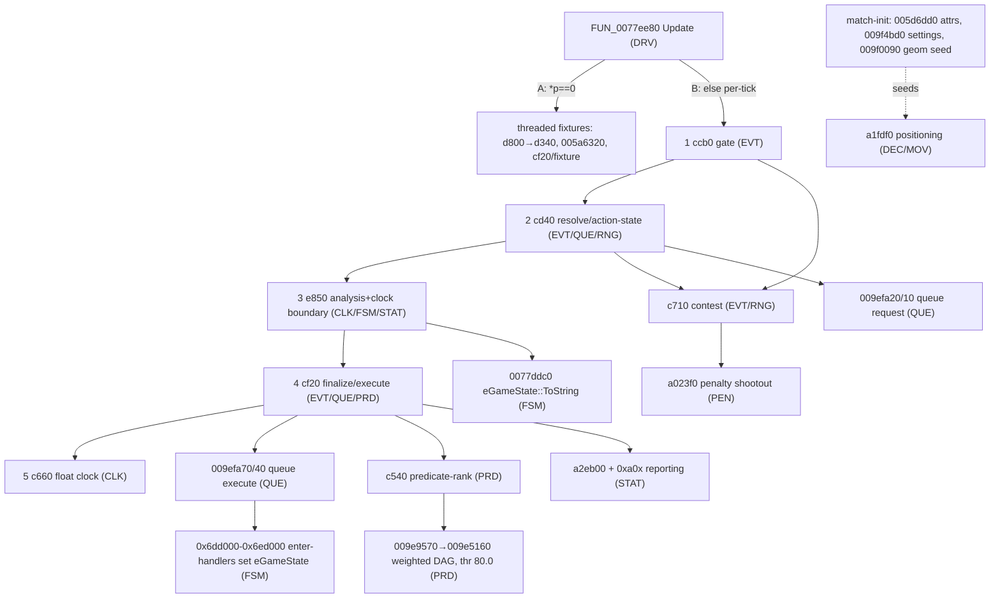

# Detailed (Minute-by-Minute) Match Engine — Call Graph

**Workstream 3.** Static only, committed Ghidra dumps. Root = `FUN_0077ee80`
(`GCMatchModule::Update`, vtable `0x00ba2904` slot `+0xa8`). Edges extracted from decompiled
bodies in `docs/ghidra_dumps/raw/match_engine.c`, `match_ai/match_movement_ai.c`,
`match_player/decompiled.c`, `raw/core_formulas.c` (`scratchpad/callgraph.py`); byte-level
edges (009ef / 009e / 009f / 0x6ddxxx / a023f0) carried from `research/` and tagged.
Tags: **[V]** VERIFIED (edge in a dump body), **[B]** byte-verified in research/, **[I]**
inferred, **[U]** unknown/bounded. See `DETAILED_MATCH_ENGINE_FUNCTION_MAP.md` for roles.

Reachability (BFS over the corpus): **657** functions total from the root (373 with bodies,
284 referenced-only); **172** are match-engine-relevant, the rest shared CRT/container/string
utilities pulled in transitively.

---

## 1. Top-level rooted tree (subsystem-grouped)

```
FUN_0077ee80  GCMatchModule::Update  [V]   ── DRIVER / TICK
│
├── (A) *param_1 == 0  : BACKGROUND / THREADED-FIXTURE branch
│     ├── FUN_0077d800  fixture-tree insert [V] ── DRV
│     │     └── FUN_0077d340  tree rebalance [V]
│     ├── (**code)(*(ctx+0x30)+4 / +0xc)   module-manager vcalls [V]
│     ├── FUN_005a6320  entity→handle [V] ── CTX
│     ├── FUN_00411c10  log "End of fixture %d that ran on a thread." [V] ── STAT
│     ├── FUN_009efc90 / FUN_0056b600  free/teardown [V]
│     └── FUN_0077cf20(fixture)  per-fixture finalize [V]   → (see C)
│
└── (B) else : DETAILED PER-TICK branch  ─── confirmed order ccb0→cd40→e850→cf20→c660
      │
      ├─1─ FUN_0077ccb0  pause/abort-restart gate [V] ── EVT/DRV
      │       ├── FUN_0077c710   contest (force-resolve) [V] → (see EVT)
      │       ├── FUN_005a6330   pool-D action record [V] ── CTX
      │       └── FUN_0040adf0(0x414)  command emit [V] ── STAT
      │
      ├─2─ FUN_0077cd40  resolve / action-state dispatch [V] ── EVT/QUE/RNG
      │       ├── FUN_005a6320 → FUN_006a00f0   bind team/camera ctx+0x98 [V/I]
      │       ├── FUN_007e7c10   RNG cell;  LCG x*0x19660d+0x3c6ef35f [V/B] ── RNG
      │       ├── FUN_009efa20 → 0x9f9400   QUEUE request (+0x10818/+0x1081c) [B] ── QUE
      │       ├── FUN_009efa10 → 0x9f7d90   QUEUE request (+0x1072c)          [B] ── QUE
      │       ├── FUN_0077c710   CONTEST [V]  → (see EVT)
      │       │     └── writes action-state  [d-rec+4] = (old&0xffff3fff)|0x3000 [V/B]
      │       ├── FUN_0048ba30  phase predicate [V] ── FSM
      │       ├── FUN_009d5c20 / FUN_009d0060 / FUN_0077cc30  aux [V]
      │       └── FUN_0040adf0(0x412/0x495/0x43a)  command emit [V] ── STAT
      │
      ├─3─ FUN_0077e850  match-analysis / FREEZE logger + clock boundary [V] ── CLK/FSM/STAT
      │       ├── FUN_009efa90   matchCtx getter (*(this+4)+0x110) [B] ── CTX
      │       ├── reads *(ctx+0xe4)+0x4c  vs DAT_00c84c7c=3600.0f  [V]  ── CLK boundary
      │       │        AND *(ctx+0xd8)+0x4b4 < 500000  ⇒ HalfOver/GameOver trigger [V]
      │       ├── FUN_0048b4c0 / 0048ba60 / 0048f140 / 00493df0 / 0048b480  phase preds [V] ── FSM
      │       ├── FUN_009efb10   event-result getter (*(ctx+0x1081c)) [B] ── QUE
      │       ├── FUN_0077ddc0   eGameState::ToString (switch 0..0x1f) [V] ── FSM
      │       └── FUN_00411c10   ">>>SOAKDATA>>> MatchFreeze(%d) MatchFreezeText(%s)" [V] ── STAT
      │
      ├─4─ FUN_0077cf20  finalize / event-execute [V] ── EVT/QUE/PRD
      │       ├── FUN_00a2eb00(param_1)   per-fixture stat/report writer [V] ── STAT
      │       │        (guarded by DAT_00c31b34 + active-team match via 005a06c0/005a61c0)
      │       ├── FUN_009efa70 → 0x9f9760   EXECUTE queued event [B] ── QUE
      │       ├── FUN_009efa40 → 0x9f2410   CONSUME (+0x10818? , +0x1072c∈[2,3]) [B] ── QUE
      │       │        └──▶ (event-execution consumer) ──▶ eGameState commit  [U/I]
      │       │               ──▶ 0x6dd000–0x6ed000 enter-handlers: mov [*(ctx+0xe4)+0x30]=state [B]
      │       ├── FUN_0069a610  rank gate [V] ── PRD
      │       │     └── FUN_0077c540  PREDICATE-RANK driver [V]  → (see PRD)
      │       ├── FUN_0077c5e0 (×2)  per-team ranked-event apply [V] ── EVT
      │       ├── FUN_00661270 / 005a6170 / 00593cc0  team gate/collection [V] ── CTX
      │       ├── FUN_009efc30 → 0x9f0c40  waypoint flush / report [B] ── MOV/QUE
      │       └── clears pending bit ctx+0x18 &= 0xfef7ffff [V]
      │
      └─5─ FUN_0077c660  continuous float CLOCK [V] ── CLK
              └── FUN_009efa90  matchCtx getter [B]
                   reads *(ctx+0xe4)+0x44 (elapsed) + +0x48 (base) → h/m bitfield [V]
```

---

## 2. EVT — contest / event resolution subtree

```
FUN_0077c710  attribute-weighted contest + sub-event generator  [V shape / I mapping]
│   rating = (*(rec+0x3c) >> 0xc) & 0x7f ;  share = rA/(rA+rB) * _DAT_00bbb51c(0.5)
│   draw   = LCG x*0x19660d+0x3c6ef35f ;  fcomp uniform vs share → winner
├── FUN_007e7c10    RNG cell [B] ── RNG
├── FUN_005a6170(0/1)   two team probes [V] ── CTX
├── FUN_005ccf30    team count [V] ── CTX
├── FUN_005cdcf0(team) iterate players ; FUN_005cd020(team) apply tally [V] ── EVT
├── FUN_00476350    contest RNG ; FUN_005ccff0 commit outcome [V] ── EVT
├── FUN_005d0460 / FUN_00661270 / FUN_005cfc40   possession/camera path [V]
└── (DAT_00c8494c == 2) ──▶ FUN_00a023f0  PENALTY SHOOTOUT  [B] ── PEN
        best-of-5 + sudden death ; 125-draw LCG ; writes entity+0x04 bits16-18
```
Covers tackle / interception / 50-50 / loose-ball / foul / injury draws (same kernel;
per-event split INFERRED).

---

## 3. PRD — predicate / rule ranking subtree (match AI, tactical/narrative)

```
FUN_0077c540  predicate-rank driver  [V]
│   list = *(matchCtx+0x180) ;  if non-empty:
├── FUN_009efa90  matchCtx getter [B]
├── FUN_009e9570(1, ctx, list, 0x42a00000=80.0f)  WEIGHTED DAG RANKER  [B]
│     └── FUN_009e5160  per-predicate weight (GetTypeName→.data float; 84 rows) [B]
│           TeamGoals=100, Strong*/VeryBad*/Weak*=92, PlayerHad*Match*=90, …  (threshold 80 ⇒ 18 survive)
├── FUN_005cdcb0(0) / FUN_005cdcb0(1)   per-team gate [V]
│     └── FUN_009e43b0(team, ctx, ranked)   apply ranked result per team [I]
└── FUN_009e8be0  node free [V]
```

---

## 4. QUE / FSM — event-request queue → state transition

```
RESOLVE (cd40)            EXECUTE (cf20)              COMMIT (out of closure)
FUN_009efa20 → 0x9f9400   FUN_009efa70 → 0x9f9760     event-execution consumer
FUN_009efa10 → 0x9f7d90   FUN_009efa40 → 0x9f2410  ──▶ 0x6dd000–0x6ed000
  writes module queue       reads +0x10818 pending       per-state __thiscall enter-handlers
  +0x1072c request-type     +0x1072c ∈ [2,3]             mov [*(ctx+0xe4)+0x30] = <eGameState>
  +0x10818 pending-flag     clears +0x10818              + reset +0x20/+0x24/+0x2c/flags/timers
  +0x1081c result-index                                  29 sites  [B located / I bridge]

Lifecycle:  InPlay(0) → *Spotted (queued @cd40) → *Activated (executed @cf20) → InPlay/ApresGoal(0x0d)
Boundary (e850):  (*(ctx+0xe4)+0x4c ≥ 3600.0) OR (*(ctx+0xd8)+0x4b4 ≥ 500000) → HalfOver(0x0b)/GameOver(0x0c)
```
The 009ef family writes the **queue record on the module `this`**, never the `ctx+0xe4`
state sub-object (byte-scan: 0 writes to `+0x30`, 0 reads of `+0xe4`) — MATCH_STATE_EFFECTS §1.

---

## 5. MOV / DEC — movement, positioning, player decision

```
match-init (not per-tick, seed the inputs):
  FUN_005d6dd0  harvest 101 PlayerConstant attrs → 0–100 array  [B] ── DEC input
  FUN_009f4bd0  harvest ResolverSettings (gait speeds/accel, MarkingDistanceScale=0.02, pos scales) [B] ── MOV input
  FUN_009f0090  seed per-entity 1012-byte float block (pos +0xc0/+0xd0, pace/accel +0xd8..+0xe8) [B]

per-tick positioning / decision (movement_ai dump; reached via FUN_00724790 trampoline):
  FUN_00a1fdf0  player movement / positioning evaluator  [V structure]
  │   iterate roster *(DAT_00c78384+0x24) stride 0x3c ; active gate *(rec+0x3a)>>0x14&1
  │   read attrs by name: Acceleration, Agility, Anticipation, DecisionMaking, Marking, Passing, …
  ├── FUN_005a0e90 / 005aa1f0 / 005af010 / 005a5010 / 00584b30  teammate/opponent target lists [I]
  └── writes target-position / run-assignment via opaque +0x3c-stride helpers  [I target-field]

per-frame advance:  NO pos+=vel·dt (0 image-wide)  ── double-buffer cur/prev @+0xc0/+0xc4(X),+0xd0/+0xd4(Y)
                    SET cur = computed target (data-driven) then interpolate prev→cur  [B absence / U picker]
waypoint flush:  cf20 → FUN_009efc30 → 0x9f0c40 → 0x9fd680/0x9fd690 → 0x65fe90 (refs @+0xb4..+0xba) [B]

GOALKEEPER:  no dedicated recovered function.  Save/catch/parry logic folded into the
             Tackling/Defensive formula family (113 formulas, encrypted trees) + GK perf
             stats (ShotsHeld/Parried/Tipped/Fumbled).  [U bounded — FORMULA_CONSUMER_MAP §4]
```

---

## 6. STAT — stats / reporting side-effects

```
FUN_0077cf20 → FUN_00a2eb00   per-fixture stat/report writer  [V edge]
             → 0xa0x reporting cluster (a0a4d0/a0cb90/a0ddc0/a0eb00/a0f1b0/a0f660/…)  ~51 funcs [V reachable / I role]
FUN_0040adf0(0x412/0x414/0x43a/0x495)   render/report command emit  [V]
FUN_00411c10   formatted log (fixture end, SOAKDATA MatchFreeze)    [V]
Performance/Condition stat slab (+0xe/+0x10):  produced by live formula eval FUN_00818120;
   NO direct writer in the recovered formula closure (VERIFIED absence); real-time stat
   mutators are native callees out of closure  [U/I]
```

---

## 7. Mermaid (condensed top-level)


